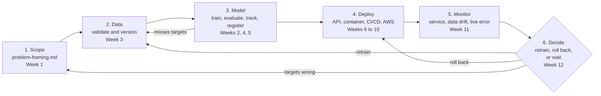

# Lifecycle: Diamond Price Prediction

Instructor solution for Practical 1, Part C (tag `m01`). It shows every stage
of the ML lifecycle for this project, the course week that builds it, and the
loop back from monitoring to data.

GitHub and VS Code render the diagram below. To edit it, paste the code block
into [mermaid.live](https://mermaid.live).

## Stages

| Stage | Question it answers | Output on the diamond project | Week |
|---|---|---|---|
| 1. Scope | Who uses the prediction, and what is "good"? | `docs/problem-framing.md`: users, targets (MAE 300 USD or less, p95 latency 500 ms or less), risks | 1 |
| 2. Data | Is the data valid, and which version trained the model? | Validated `diamonds.csv`, tracked by DVC | 3 |
| 3. Model | Is this model better than the current one? | Tracked runs in MLflow. The best model gets the `champion` alias | 2, 4, 5 |
| 4. Deploy | Can other programs use the model, safely and repeatably? | Batch job, FastAPI service, Docker image, CI/CD, AWS Lambda | 6 to 10 |
| 5. Monitor | Is the service healthy, and is the model still right? | Prometheus and Grafana dashboards, Evidently drift report, live error | 11 |
| 6. Decide | The model got worse. What now? | Retrain a challenger, roll back `champion`, or wait for more data | 12 |

## The loops

- **Model misses targets → Data.** Most model problems are data problems.
  Check the data before tuning the model.
- **Retrain → Data.** New data with real sale prices goes back through
  validation before any retraining.
- **Roll back → Deploy.** If the new model is worse, move `champion` back to
  the previous version. No retraining needed.
- **Targets wrong → Scope.** Sometimes monitoring shows the targets were wrong
  (for example, sellers need a faster answer). Change the framing first.

## Today (`m00`)

Only stage 3 exists, and only inside a notebook. Every other box is built
during the course.
