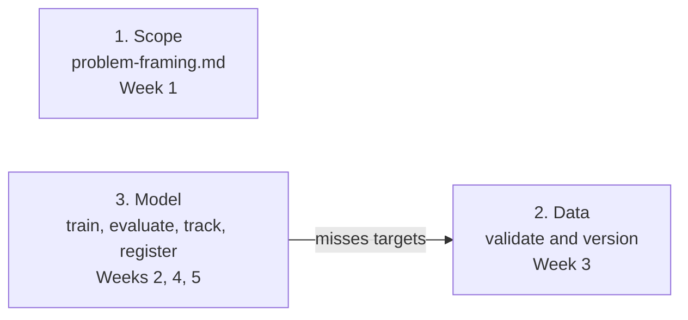

# Practical 1: Maturity assessment and problem framing

## Goal

Before you automate anything, you need to know two things: how mature a team's ML work is today, and what "good" means for the model. In this practical you score a fictional company on the maturity model, then write the scope document and the lifecycle diagram for the diamond project.

**This week's evidence:** a diamond lifecycle diagram and a problem framing with measurable success criteria (metric, threshold, latency, cost).

| Part | What you do | File | Time |
|---|---|---|---|
| A | Score a company on Levels 0 to 4 for each of the 8 pillars. Recommend the next 3 changes | `docs/maturity-assessment.md` (new) | 45 min |
| B | Frame the diamond problem: answer 4 questions with numbers you can check | `docs/problem-framing.md` | 75 min |
| C | Draw the diamond lifecycle, with the loops back | `docs/lifecycle.md` | 40 min |

In the session you start Part A in pairs. Each student submits their own files.

No code runs this week. You write 3 Markdown files and one diagram.

## Before you start

- Your Week 0 setup check passed: `bash scripts/verify_setup.sh` ended with `Setup ready: all 3 checks passed.`
- Keep the Week 1 slides open. You need these slides: "The course scale" (the level table), "Score a team per pillar" (the grid), "Vague goals vs measurable targets", "Two kinds of targets" and "8 pillars across the course".

## Step 1. Switch to the Week 1 starting branch

Run these in your Linux terminal (Ubuntu in WSL2 on Windows), inside the starter repo you cloned in Week 0.

```bash
git fetch upstream
git switch -c my-m01 upstream/start-m01
cd diamond-mlops
code .
```

- `git fetch upstream` downloads the Week 1 starting branch from the course repo (`upstream`, added in Week 0 Step 7). Your fork normally does not have it: a fork copies only `main`. `git switch -c my-m01 upstream/start-m01` makes your own branch from it, so your work stays separate from the course branch.
- On Windows, check that the bottom-left corner of VS Code says **WSL: Ubuntu**.

You should see 2 files with `TODO` lines in `docs/`:

- `docs/problem-framing.md` (Part B)
- `docs/lifecycle.md` (Part C)

Part A goes in a new file: `docs/maturity-assessment.md`.

---

## Part A. Score a company on the maturity model

### A1. Read the scenario

> **Pedalway is a fictional company.** Any match with a real company is a coincidence.
>
> Pedalway runs a bike-share network with 180 stations in one city. Every morning 6 trucks move bikes from full stations to empty ones. Since last year a model predicts the hourly bike demand at each station for the next day. The dispatch app turns that forecast into truck routes.
>
> **Team.** 2 data scientists, 1 data engineer, 4 software engineers. Nobody has the title ML engineer.
>
> **Data.** Every Monday the data engineer runs a SQL query against the trips database by hand and saves the result as `trips.csv` on a shared network drive. Each export overwrites last week's file. Nobody checks the columns or the values. In March the station ID format changed from numbers to text. The training notebook silently dropped 12% of the rows. Nobody noticed for 3 weeks.
>
> **Training.** A data scientist trains the model in a Jupyter notebook on her laptop, about once a month. The notebook is committed to Git. There are no tests for it, and the settings are typed into the cells. The Python packages on her laptop are whatever she installed over the year; there is no requirements file. She records each run in a spreadsheet by hand (date, settings, error). Some months she forgets.
>
> **Release.** The dispatch app is a Django web app that runs in a Docker image. A GitHub Actions pipeline runs 400 unit tests on every pull request, and every merge to `main` builds the image and deploys it to AWS. None of the 400 tests load the model. To ship a new model, the data scientist emails `model.pkl` to a software engineer. He commits it to the app repo, and the pipeline deploys it. Nothing checks the model's error before it goes live.
>
> **Monitoring.** The app has a dashboard with uptime, response time and server errors. An alert pages the on-call engineer when errors pass 1%. Nobody compares the forecasts with the real demand. Last summer truck drivers complained for 6 weeks that stations were empty when the forecast said they would be full.
>
> **Plans.** The head of data says: "We will start using MLflow next quarter, and add drift monitoring after that."

### A2. Score each pillar

Use the course scale (the "The course scale" slide) and this guide, which splits it by pillar. The guide is the same as the "Score a team per pillar" slide.

| Pillar | Level 0 looks like | Evidence for Level 1 or 2 | Evidence for Level 3 or 4 |
|---|---|---|---|
| Version everything | Files on laptops, `final_v2.csv` | Code in Git (L1); data and models versioned and tied to each run (L2) | Every deployed model traces to its data, code and config |
| Track experiments | Results in a spreadsheet or not at all | Every run tracked centrally; a registry says which model is live (L2) | Promotion follows a written rule, applied automatically (L4) |
| Orchestrate | Cells run by hand | Training is a repeatable, scheduled or triggered pipeline (L2) | Monitoring alerts trigger the pipeline (L4) |
| Serve | Model file emailed to an engineer | Scoring code version controlled and tested (L1) | Deployment automated through CD (L3) |
| Containerize | "Works on my machine" | Defined, pinned environments for training (L2) | The same image runs in test and production (L3) |
| CI/CD | Manual builds | CI runs tests on every push (L1) | Model release through CD with tests (L3) |
| Monitor | Nobody would notice | Training performance tracked (L2) | Live model and service metrics (L3); drift triggers retraining (L4) |
| Infrastructure as code | Clicked together in a console | Environment definitions in files (L2) | Whole environment (train, test, prod) managed as code (L3) |

How to score:

1. **Score each pillar on its own**, from what the team does **today**. A plan is not evidence.
2. **Score the ML work.** Pedalway's app is well engineered. Ask what is true for the model: its data, its training and its release.
3. **When two levels seem to fit, take the lower one**, and write what is missing for the higher one. One trait alone is not a level. "Level 0, with one Level 1 trait" is a valid score.
4. **If the scenario does not say, write "not stated"**, and write the question you would ask the team. Do not guess. This is the same habit as the Aramex discussion: score from evidence, and say what is unknown.

### A3. Write the score sheet

Create `docs/maturity-assessment.md` with these 4 sections. One page is enough.

1. **A score table** with 3 columns: Pillar, Level (0 to 4, or "not stated"), Evidence. One row for each of the 8 pillars. The Evidence column points to a fact in the scenario.
2. **Overall score** in the form "mostly Level X, some Level Y", with one sentence on why.
3. **Next 3 changes, in order.** For each change: what to do, which pillar it moves up, and one reason it comes at this point in the order.
4. **The "Plans" paragraph.** One sentence: does it change any score? Why or why not?

Here is an empty table you can copy:

```markdown
# Maturity assessment: Pedalway (fictional)

| Pillar | Level | Evidence |
|---|---|---|
| Version everything | | |
| Track experiments | | |
| Orchestrate | | |
| Serve | | |
| Containerize | | |
| CI/CD | | |
| Monitor | | |
| Infrastructure as code | | |
```

**Common mistakes in Part A**

- "Level 1 means the model is automated." At Level 1 only the code is engineered. Training and hand-off are still manual.
- "Level 2 means CI/CD for models." At Level 2 the release is still manual. Automated deployment starts at Level 3.
- Giving the app's strengths to the model. The app has CI/CD; the model reaches it by email.
- Ordering the next changes from the top down, for example automatic retraining before training is tracked and tested. Each step needs the one below it.

---

## Part B. Frame the diamond problem

Open `docs/problem-framing.md`. Replace every `TODO` with your own answer, and replace the first line under the title ("Practical 1, Part B. Complete each TODO ...") with one line of your own. Keep the 4 headings.

The diamond project needs a business story before it can have targets.

- You may use **Sparkle Exchange** from the slides, or invent your own company. Either way, write that it is fictional.
- If you use Sparkle Exchange, add at least one user, target or risk of your own that is not on the slides.
- Your numbers can differ from ours. Each one needs a reason, and someone else must be able to check it.

### B1. Who uses the prediction, and how?

- Name at least 2 users. For each: what they do with the prediction, and what they need from it (speed, accuracy, trust).
- Say whether predictions are needed one at a time (online), in a group (batch), or both. This shapes Week 6.
- Say who makes the final decision: the model or a person. This limits how much damage a wrong prediction can do.

### B2. What does "good" mean?

Write a table of targets. You need at least these 3, each with a number:

| Target | Example of the form (pick your own number) |
|---|---|
| Model metric and threshold | "MAE of N USD or less on the fixed holdout set" |
| Latency | "p95 latency of N ms or less per request" |
| Cost | "N USD a month or less on AWS" |

For each target, also write:

- **Why this number.** Tie it to the user or the data. Useful facts: the average diamond in `data/raw/diamonds.csv` costs about 3,933 USD. The notebook today gives MAE 279.29 USD and R2 0.9826 on the 10,755 holdout rows.
- **Where it stands today.** Use the notebook numbers for the model metric. For anything that does not exist yet, write **"not measured"**. There is no API yet, so latency is "not measured". Nothing runs on AWS yet, so the AWS cost is "not measured" too (running the notebook on your laptop is not the AWS cost). A target that is not measured never counts as passed.
- **Which kind of target it is.** An **offline model gate** is checked on the fixed holdout before a model can be released. A **release or operating target** (latency, batch run time, cost) is checked once that part of the system exists.

A quick test: a target is measurable when two people would measure it the same way and get the same pass or fail. "The model should be accurate" fails this test. "MAE of 300 USD or less on the fixed holdout set" passes. If you are stuck, ask yourself: "What number would make me reject this model?"

### B3. What can go wrong in production?

List at least 3 risks in a table with these columns: Risk, Example on the diamond project, How it will be caught, Course week that adds the check.

Pick them from at least 2 of these kinds:

- bad input data
- results that cannot be reproduced
- a worse model gets released
- the world changes (the inputs shift, or prices change)
- the service is down, slow or too expensive

The "8 pillars across the course" slide shows which week builds each check.

### B4. Where is the project on the maturity model today?

- Pick a level for the diamond project as it is on `start-m01`, on the course scale.
- Give at least 3 pieces of evidence from the repo. Look at the notebook, `README.md` and `scripts/`. Be precise. For example: what does `scripts/verify_setup.sh` check, and what does it not check?
- Recommend the next 3 changes in order, each with one reason. Same form as Part A.

---

## Part C. Draw the diamond lifecycle

Open `docs/lifecycle.md`. Replace every `TODO`, and replace the first line under the title ("Practical 1, Part C. ...") with one line of your own.

### C1. The diagram

Your diagram must show:

- **6 stages:** Scope, Data, Model, Deploy, Monitor, Decide (retrain, roll back, or wait).
- **The course week** that builds each stage.
- **At least 2 loops back.** Required: Decide back to Data (retrain), and Decide back to Deploy (roll back). For full marks, add at least one more: Decide back to Scope (the targets were wrong), or Model back to Data (the model misses its targets).

A lifecycle that ends at Deploy is the most common mistake. Every lifecycle in this course loops back from monitoring.

**Mermaid is recommended.** The diagram lives in the Markdown file as text, so Git tracks every change to it. Put your diagram in a fenced code block with the language `mermaid`. These lines are copied from the course solution, `diamond-mlops/docs/lifecycle.md` at tag `m01` (7596237), and draw on their own:

````markdown

````

They show the syntax you need: a box with a quoted label (`SCOPE["..."]`) and an arrow with a label (`-->|text|`). A plain arrow is `-->` with no label, for example `SCOPE --> DATA`. For a decision, curly braces (`{"..."}`) draw a diamond shape. The rest of the diagram is yours.

Paste your code into the [Mermaid Live Editor](https://mermaid.live) and fix any error before you commit. GitHub also draws Mermaid blocks in `.md` files. Reference: [Mermaid flowchart syntax](https://mermaid.js.org/syntax/flowchart.html), sections **Node shapes**, **Links between nodes** and **Special characters that break syntax**.

Any other tool is fine too (draw.io, Excalidraw, paper and a photo). Save the picture as a PNG in `docs/` and link it from `lifecycle.md`.

### C2. Stages and outputs

Under the diagram, write a table with one row per stage: Stage, Question it answers, Output on the diamond project, Week.

### C3. The loops

For each loop in your diagram, write 1 or 2 sentences: what event starts it, and why it goes back to that stage and not another.

---

## Step 2. Check your work

From the `diamond-mlops` folder:

1. Run `grep -n TODO docs/*.md`. It must print nothing. If it prints a line, that part is not finished.
2. If you used Mermaid: paste your code into mermaid.live. It must draw with no error. If you used a PNG: check that the file is in `docs/` and that the link in `lifecycle.md` opens it in the VS Code Markdown preview.
3. Read each target in Part B out loud. Does it have a number, a unit and a clear pass or fail? If not, fix it.
4. Commit your files on your branch:

```bash
git add docs/maturity-assessment.md docs/problem-framing.md docs/lifecycle.md
git commit -m "Practical 1: maturity assessment, problem framing, lifecycle"
```

If you used a PNG, add it to the `git add` line too. The commit keeps your work safe on your own computer. You do not push this week.

## What to submit

Upload these 3 files to the course site:

1. `docs/maturity-assessment.md` (Part A)
2. `docs/problem-framing.md` (Part B)
3. `docs/lifecycle.md` (Part C), plus the PNG if you did not use Mermaid

Due before the Week 2 session.

## Done when

- [ ] `docs/maturity-assessment.md` scores all 8 pillars. Each score has evidence from the scenario, or says "not stated" with the question you would ask.
- [ ] It gives an overall score ("mostly X, some Y") and the next 3 changes in order, each with a reason.
- [ ] `docs/problem-framing.md` answers all 4 questions. `grep -n TODO docs/*.md` prints nothing.
- [ ] Part B has a model metric with a threshold, a latency target and a cost limit. Each has a number, a reason and today's status. Nothing unmeasured is marked as passed.
- [ ] Part B lists at least 3 risks from at least 2 kinds, each with an example, how it will be caught, and the course week that adds the check.
- [ ] `docs/lifecycle.md` shows all 6 stages, the week for each, and at least the 2 required loops.
- [ ] If you used Mermaid, the diagram draws with no error in mermaid.live. If you used a PNG, it is in `docs/` and linked from `lifecycle.md`.

## Rubric

Each row is scored **2** (complete), **1** (partly there) or **0** (missing). Total: 16 points.

| Row | 2 points | 1 point | 0 points |
|---|---|---|---|
| A1. Pillar scores | All 8 pillars scored or marked "not stated". Each score fits the guide and points to scenario evidence | 6 or more pillars present, but the 2-point line is not met (for example, a pillar missing, or some scores ignore the guide or have no evidence) | 5 pillars or fewer, or no evidence for any score |
| A2. Overall score and next 3 changes | "Mostly X, some Y" with a reason. 3 changes in order, each with a reason that explains the order | 2 or 3 changes given, but the 2-point line is not met (for example, overall score missing, weak reasons, or automatic retraining before training is tracked and tested) | Fewer than 2 changes |
| B1. Users | At least 2 users, how each uses the prediction, online or batch, and who decides | At least 1 user named, but the 2-point line is not met | No users |
| B2. Targets | Metric with threshold, latency and cost, each with a number, a reason and today's status. Offline gate and operating targets told apart | At least 2 targets with numbers, but the 2-point line is not met (for example, a reason or status missing, or an unmeasured target marked as passed) | Fewer than 2 targets with numbers |
| B3. Risks | At least 3 risks from at least 2 kinds, each with an example, how it is caught, and a week | At least 2 risks, but the 2-point line is not met | Fewer than 2 risks |
| B4. Maturity today | A level, 3 or more precise pieces of repo evidence, next 3 changes with reasons | A level given, but the 2-point line is not met (for example, vague or wrong evidence, or changes missing) | No level |
| C1. Diagram | 6 stages with weeks, the 2 required loops plus at least 1 more. Mermaid draws with no error, or the PNG is linked | At least 5 stages and at least 1 loop back, but the 2-point line is not met | Missing, does not draw, fewer than 5 stages, or no loop back |
| C2 and C3. Stage table and loops | Table covers all 6 stages. Every loop explained | A table or at least 1 loop explanation, but the 2-point line is not met | Neither a table nor any loop explanation |

- 13 to 16 points: complete.
- 8 to 12 points: partly complete.
- 7 points or less: not complete.

Your work does not need to match anyone else's. Different choices are fine (a different company, a different threshold) as long as each one has a number and a reason.

## Troubleshooting

| You see | Likely cause | Fix |
|---|---|---|
| `fatal: invalid reference: upstream/start-m01` | Your copy has not fetched the course repo yet, or `upstream` is missing | Run `git remote -v`. If `upstream` is missing, add it with the `git remote add upstream` line from Week 0 Step 7. Then run `git fetch upstream` and the `git switch -c` line again |
| `error: Your local changes ... would be overwritten` | You changed files on another branch | Run `git status` to see them. Commit them, or ask in the course channel before you throw anything away |
| `docs/` has no `TODO` files | You are on another branch | Run `git branch --show-current`. It must print `my-m01` (made from `start-m01`) |
| `grep` still finds `TODO` after you answered every question | The first line under each title still says "Complete each TODO" | Replace that line with one line of your own |
| Mermaid shows a parse error on a box label | A special character such as `(` or `)` in a label without quotes | Put the label in double quotes: `A["Scope (Week 1)"]` |
| Mermaid shows a parse error on a box called `end` | `end` in lowercase breaks a flowchart | Write `End` or `END` |
| The first line of the diagram is rejected | The diagram type is missing | The first line inside the block must be `flowchart LR` (or `flowchart TD`) |
| An arrow label does not show | Wrong arrow text syntax | Use `A -->|label| B` |
| Your editor shows the Mermaid code as plain text | That preview does not draw Mermaid | Check it in mermaid.live, or push and look at the file on GitHub |
| "I can't decide between two levels" | The team shows traits of both | Take the lower one. In the Evidence column, write what is missing for the higher one |
| "My latency target has no value today" | There is no API until Week 6 | Write "not measured". That is the correct answer this week |
| "The scenario does not say anything about this pillar" | It is not in the scenario on purpose | Write "not stated" and the question you would ask the team |

## Reading

- **Required:** Sculley et al., [Hidden Technical Debt in Machine Learning Systems](https://proceedings.neurips.cc/paper_files/paper/2015/file/86df7dcfd896fcaf2674f757a2463eba-Paper.pdf) (NeurIPS 2015), Sections 1 to 5 (about 5 pages). It helps with Part B question 3.
- Optional: Microsoft, [MLOps maturity model](https://learn.microsoft.com/en-us/azure/architecture/ai-ml/guide/mlops-maturity-model). Our level names come from here. Note that Microsoft's Level 1 also expects automated application releases; the course scale does not.
- Optional: Google Cloud, [MLOps: Continuous delivery and automation pipelines in machine learning](https://docs.cloud.google.com/architecture/mlops-continuous-delivery-and-automation-pipelines-in-machine-learning). A shorter scale (Levels 0 to 2) to compare with ours.

## Before Week 2

- Take Quiz 1.
- Read the capstone brief.
- Week 2 turns the notebook into a tested Python package with Git, pytest and CI. That is change number 1 on our list for the diamond project.
